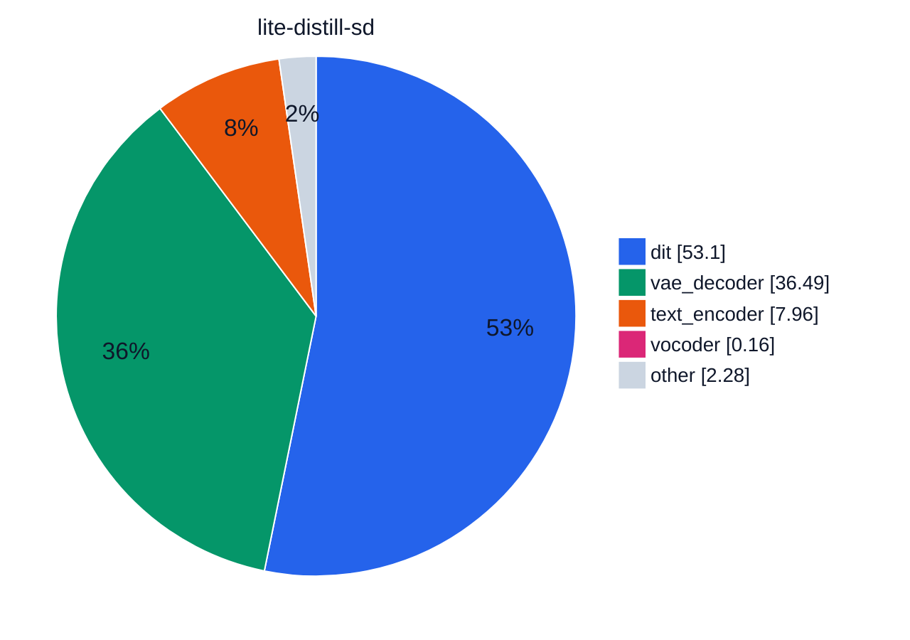
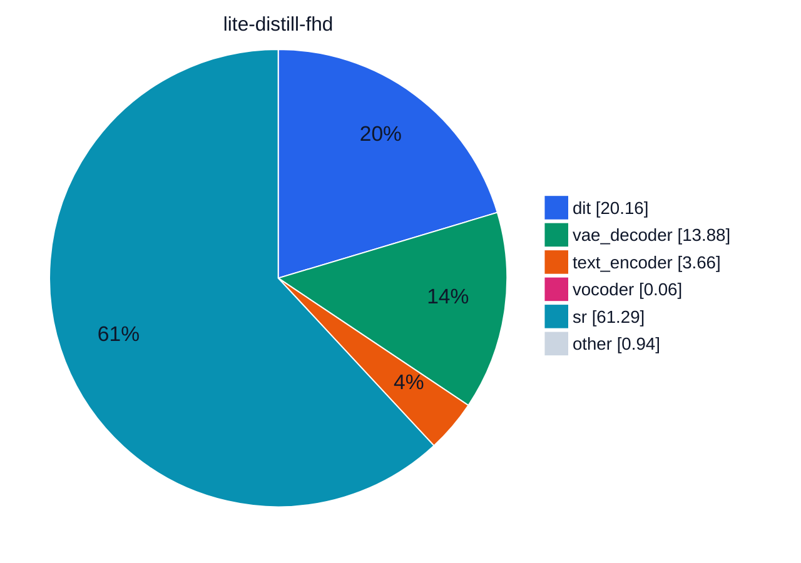
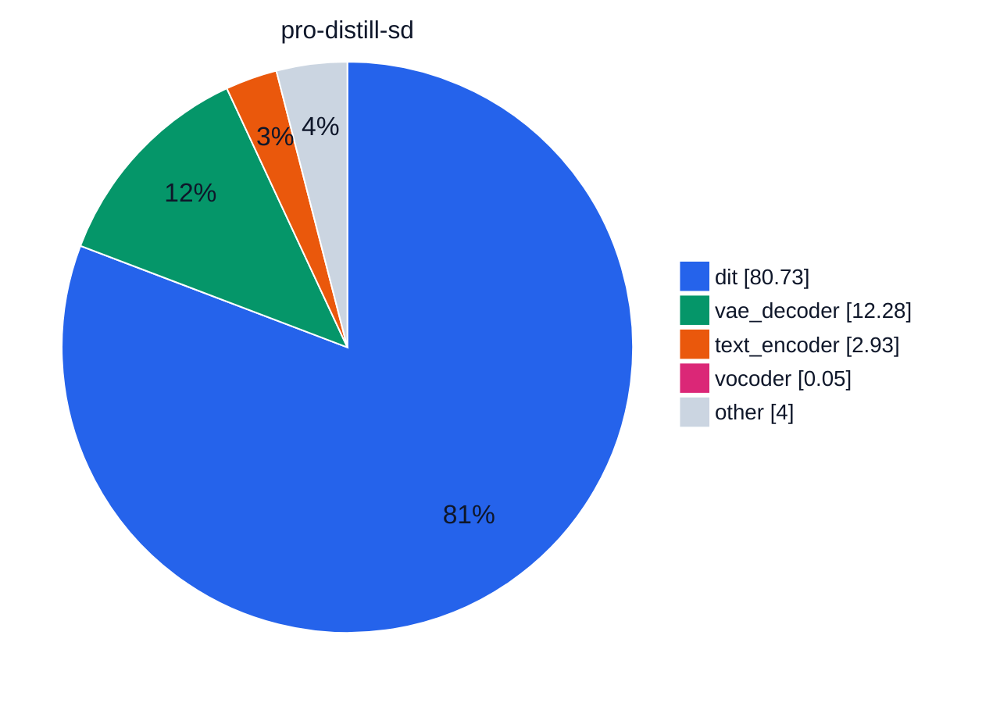
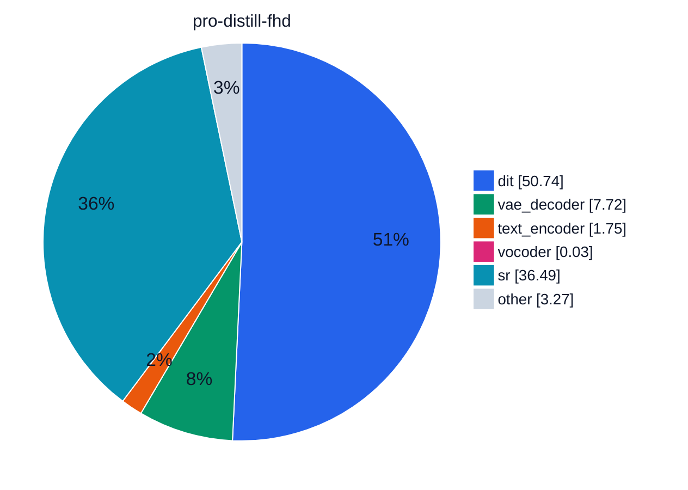
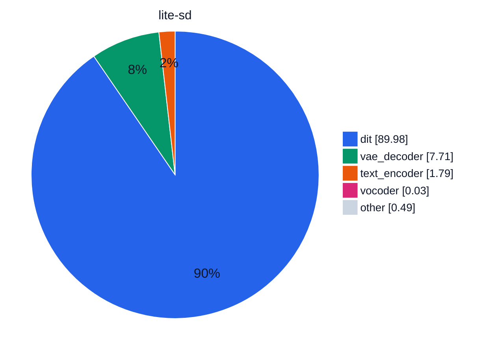
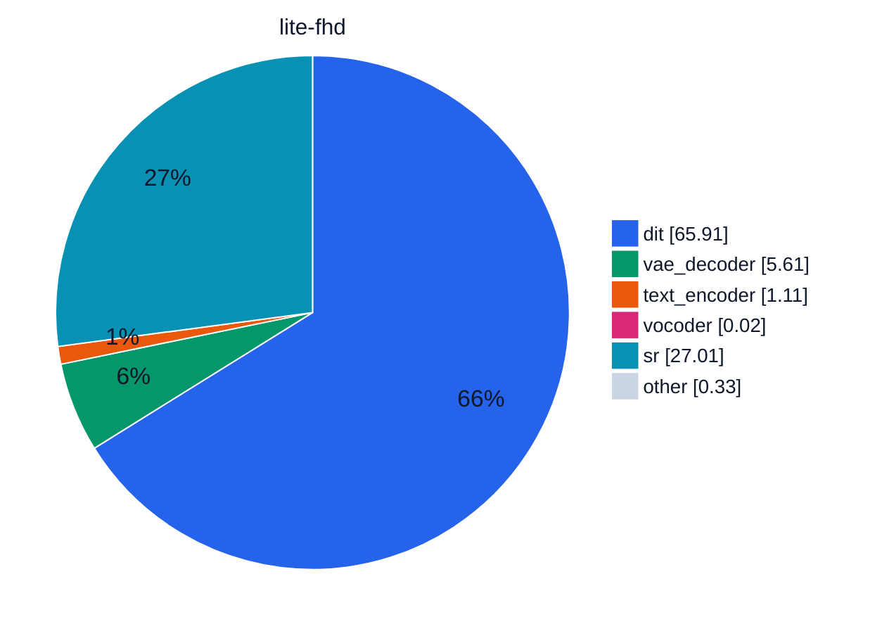
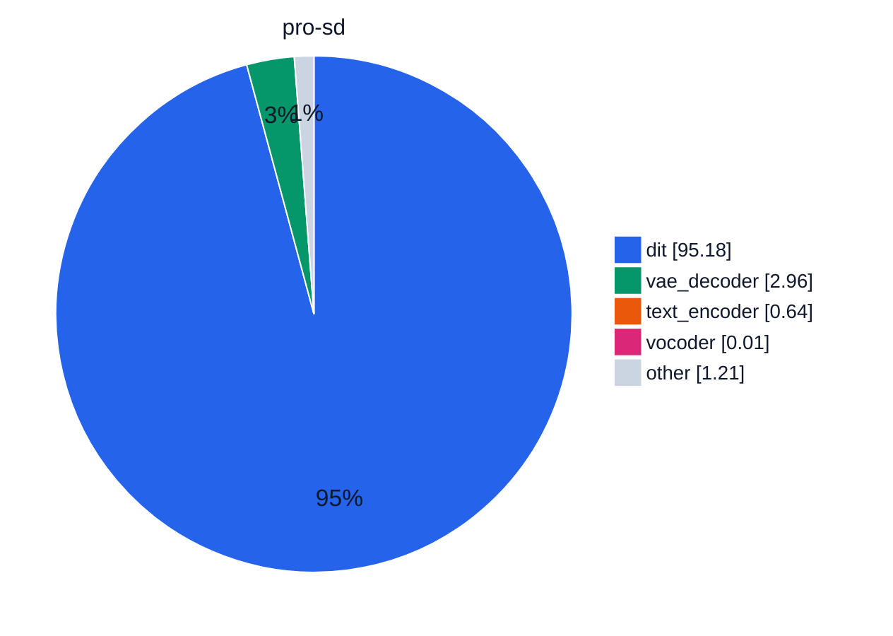
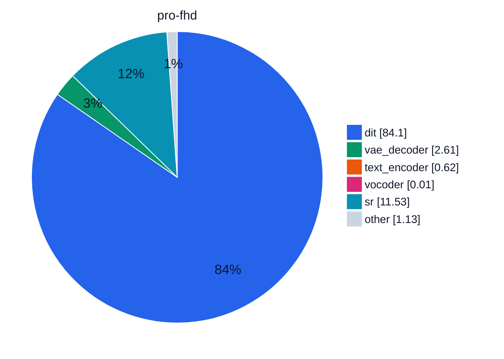

# Module time share

Collected profiles on NVIDIA A100-SXM4-80GB.

SageAttention, Qwen in BF16, compile torch. Each cell is one profiled generation. Lite stays resident. Pro uses module offload. The base clip is 480×864 with audio. Full HD is that clip plus the distilled 2-step model at scale 2.25. Distilled checkpoints use PiFlow, 10 steps, and guidance 1. The other checkpoints use 50 steps, guidance 5, and MagCache.

The time under a run name is that profile, base plus super-resolution. A slice is that module's share of the same total. Charts are [Mermaid pie charts](https://mermaid.js.org/syntax/pie.html). Slice colors are `pie1`…`pie12` on the `base` theme, set per chart so a module keeps its color. Slices under 0.01% are omitted, because a Mermaid pie value must be greater than zero.

<i style="background:#2563EB"></i>dit <i style="background:#059669"></i>vae_decoder <i style="background:#EA580C"></i>text_encoder <i style="background:#DB2777"></i>vocoder <i style="background:#7C3AED"></i>audio_vae_decoder <i style="background:#CA8A04"></i>text_encoder_2 <i style="background:#0891B2"></i>sr <i style="background:#CBD5E1"></i>other

## Charts

### Lite distill

### Pro distill

### Lite

### Pro

## Share of total time, %

Cell colors come from a `

| run | dit | vae_decoder | text_encoder | vocoder | audio_vae_decoder | text_encoder_2 | sr | other |
| --- | --- | --- | --- | --- | --- | --- | --- | --- |
| lite-distill-sd <small>78.6 s · none</small> | 53.1 | 36.5 | 7.96 | 0.16 | &lt;0.01 | &lt;0.01 | 0 | 2.28 |
| lite-distill-fhd <small>207.1 s · none</small> | 20.2 | 13.9 | 3.66 | 0.06 | &lt;0.01 | &lt;0.01 | 61.3 | 0.94 |
| pro-distill-sd <small>236.0 s · module</small> | 80.7 | 12.3 | 2.93 | 0.05 | &lt;0.01 | &lt;0.01 | 0 | 4.00 |
| pro-distill-fhd <small>375.4 s · module</small> | 50.7 | 7.72 | 1.75 | 0.03 | &lt;0.01 | &lt;0.01 | 36.5 | 3.27 |
| lite-sd <small>371.6 s · none</small> | 90.0 | 7.71 | 1.79 | 0.03 | &lt;0.01 | &lt;0.01 | 0 | 0.49 |
| lite-fhd <small>508.0 s · none</small> | 65.9 | 5.61 | 1.11 | 0.02 | &lt;0.01 | &lt;0.01 | 27.0 | 0.33 |
| pro-sd <small>980.4 s · module</small> | 95.2 | 2.96 | 0.64 | 0.01 | &lt;0.01 | &lt;0.01 | 0 | 1.21 |
| pro-fhd <small>1109.8 s · module</small> | 84.1 | 2.61 | 0.62 | 0.01 | &lt;0.01 | &lt;0.01 | 11.5 | 1.13 |

