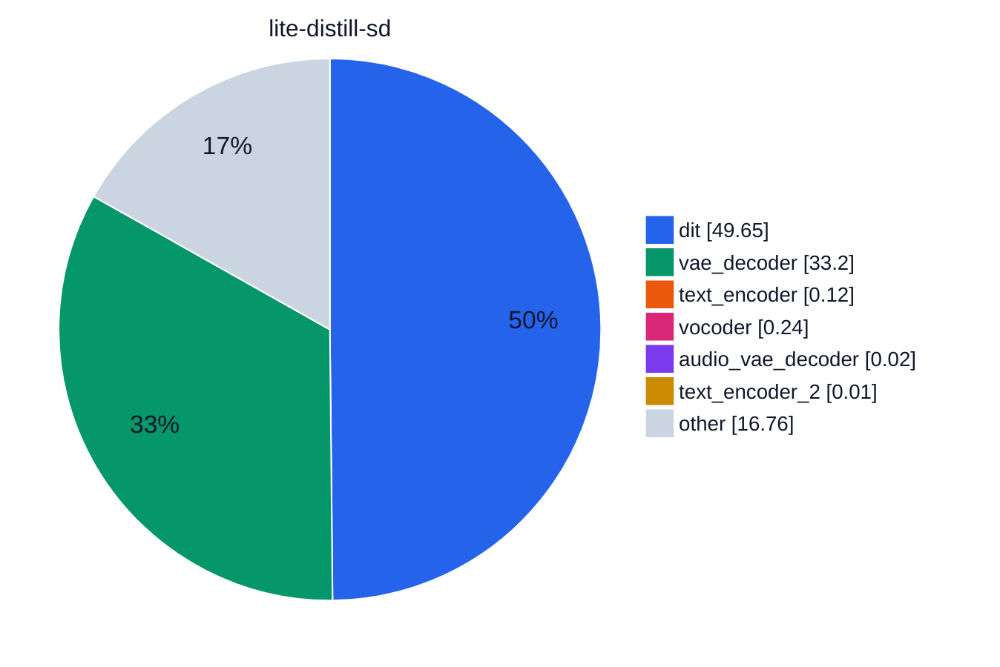
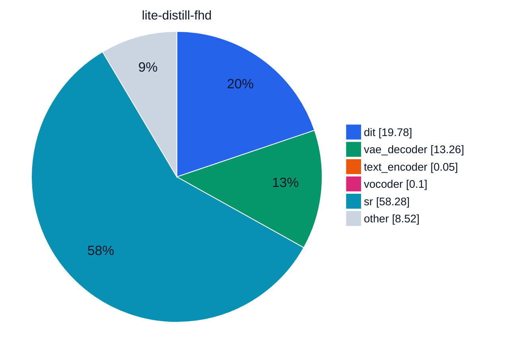
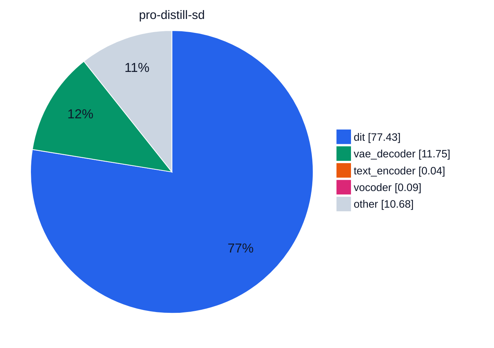
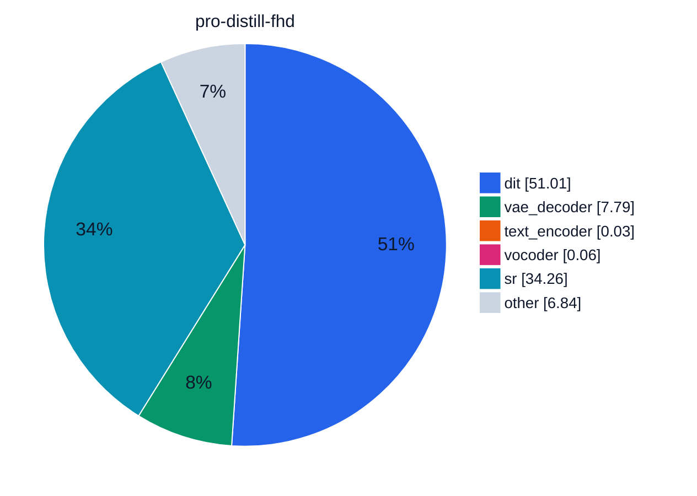
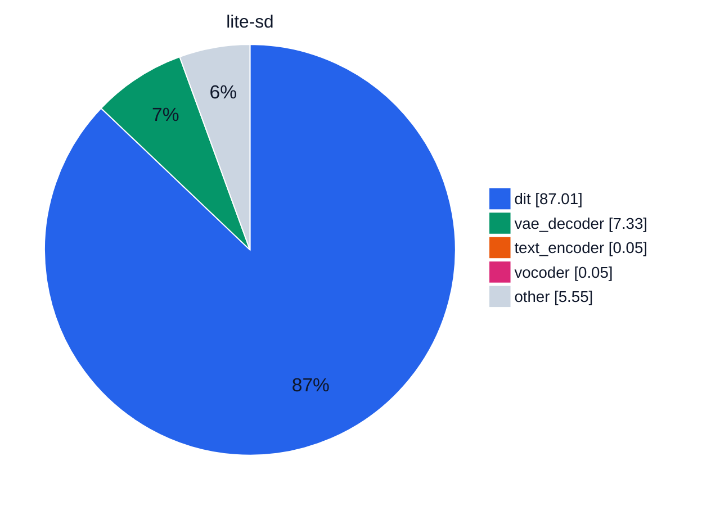
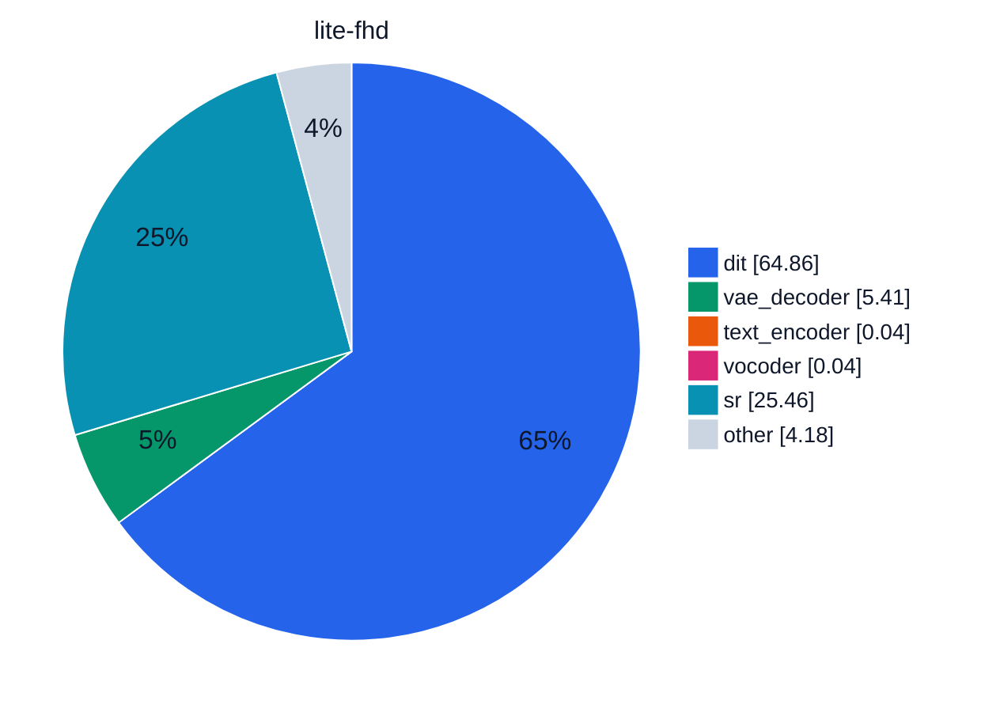
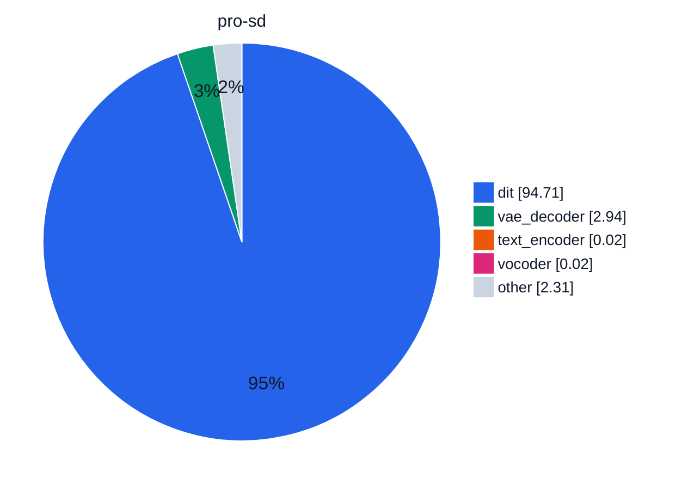
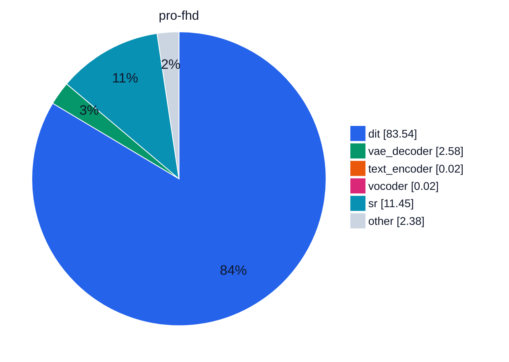

# Module time share

Run `bench_2026-10-20T20-54-28` on NVIDIA H100 80GB HBM3.

This is `just bench`. Attention is FlashAttention 3. Qwen is BF16. Compile is torch. The base clip is 480×864 with audio. Full HD super-resolves that clip with the distilled 2-step model at scale 2.25. Distilled checkpoints use PiFlow, 10 steps, and guidance 1. The other checkpoints use 50 steps, guidance 5, and MagCache. Offload is the lightest strategy that fits on the card.

The time under a run name is the median of up to three finished generations. A slice is the median time of that module across those generations, as a share of the sum of those medians. Charts are [Mermaid pie charts](https://mermaid.js.org/syntax/pie.html). Slice colors are `pie1`…`pie12` on the `base` theme, set per chart so a module keeps its color. Slices under 0.01% are omitted, because a Mermaid pie value must be greater than zero.

<i style="background:#2563EB"></i>dit <i style="background:#059669"></i>vae_decoder <i style="background:#EA580C"></i>text_encoder <i style="background:#DB2777"></i>vocoder <i style="background:#7C3AED"></i>audio_vae_decoder <i style="background:#CA8A04"></i>text_encoder_2 <i style="background:#0891B2"></i>sr <i style="background:#CBD5E1"></i>other

## Charts

### Lite distill

### Pro distill

### Lite

### Pro

## Share of total time, %

Cell colors come from a `

| run | dit | vae_decoder | text_encoder | vocoder | audio_vae_decoder | text_encoder_2 | sr | other |
| --- | --- | --- | --- | --- | --- | --- | --- | --- |
| lite-distill-sd <small>31.2 s · none</small> | 49.6 | 33.2 | 0.12 | 0.24 | 0.02 | 0.01 | 0 | 16.8 |
| lite-distill-fhd <small>78.0 s · module</small> | 19.8 | 13.3 | 0.05 | 0.10 | &lt;0.01 | &lt;0.01 | 58.3 | 8.52 |
| pro-distill-sd <small>87.8 s · module</small> | 77.4 | 11.7 | 0.04 | 0.09 | &lt;0.01 | &lt;0.01 | 0 | 10.7 |
| pro-distill-fhd <small>133.2 s · module</small> | 51.0 | 7.79 | 0.03 | 0.06 | &lt;0.01 | &lt;0.01 | 34.3 | 6.84 |
| lite-sd <small>143.2 s · none</small> | 87.0 | 7.33 | 0.05 | 0.05 | &lt;0.01 | &lt;0.01 | 0 | 5.55 |
| lite-fhd <small>192.2 s · module</small> | 64.9 | 5.41 | 0.04 | 0.04 | &lt;0.01 | &lt;0.01 | 25.5 | 4.18 |
| pro-sd <small>351.5 s · module</small> | 94.7 | 2.94 | 0.02 | 0.02 | &lt;0.01 | &lt;0.01 | 0 | 2.31 |
| pro-fhd <small>399.7 s · module</small> | 83.5 | 2.58 | 0.02 | 0.02 | &lt;0.01 | &lt;0.01 | 11.5 | 2.38 |

