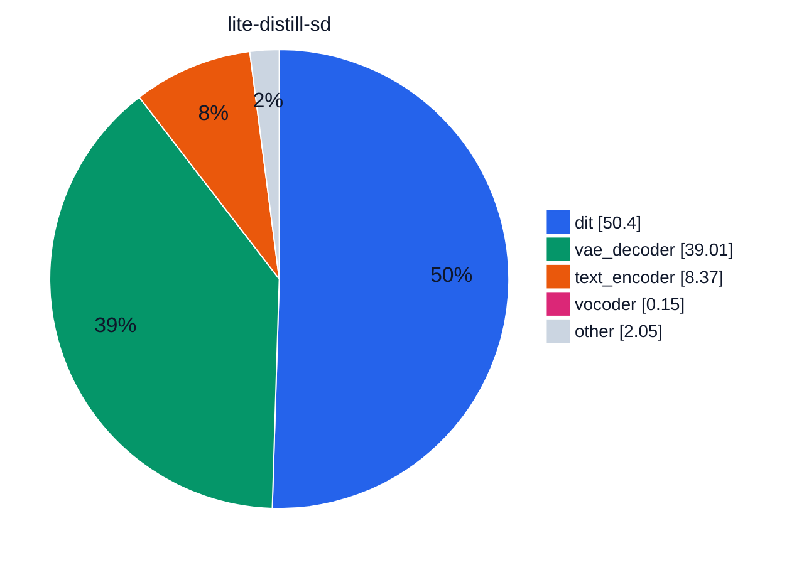
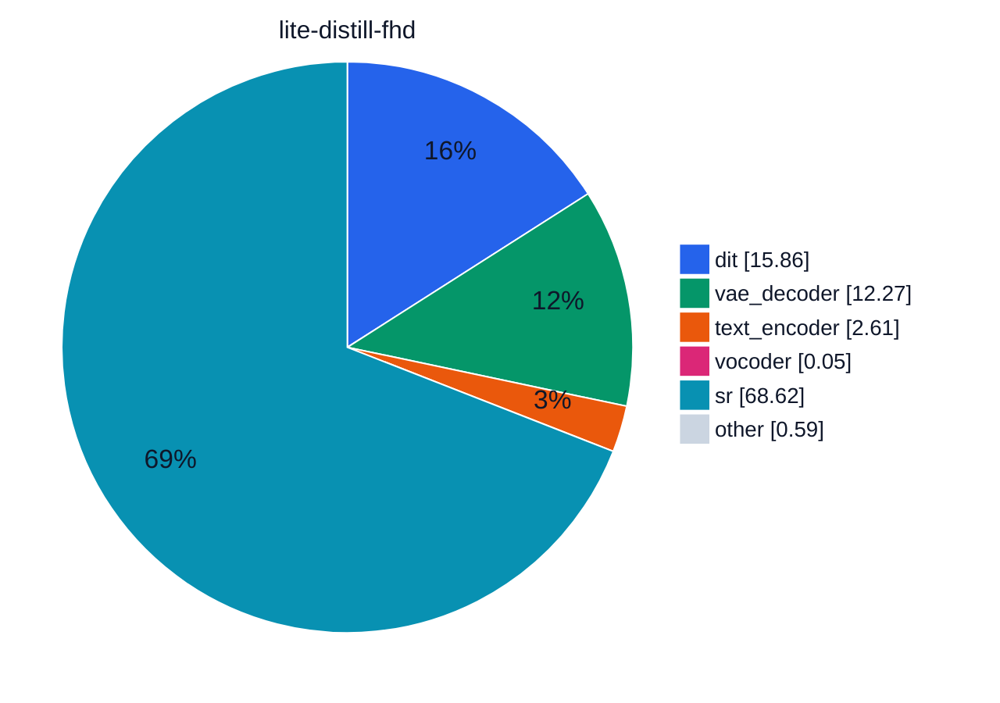
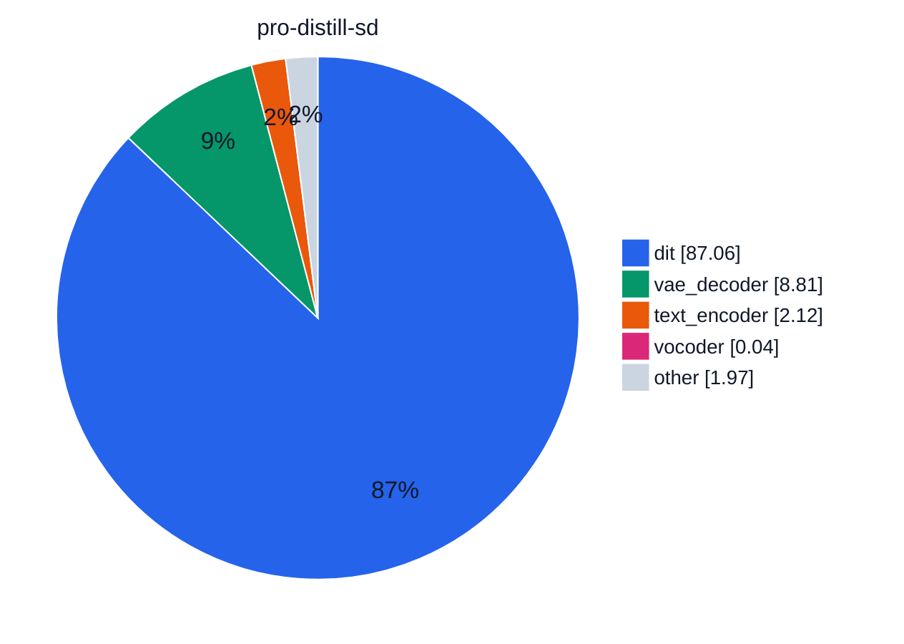
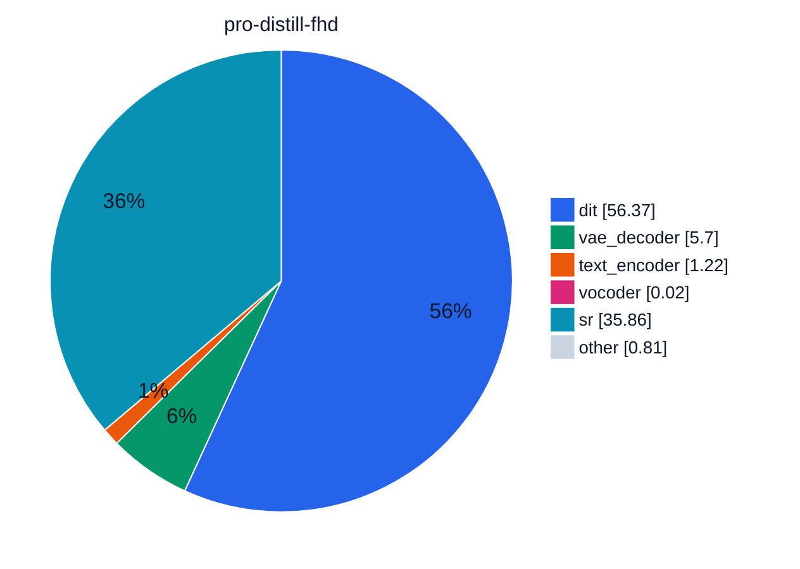
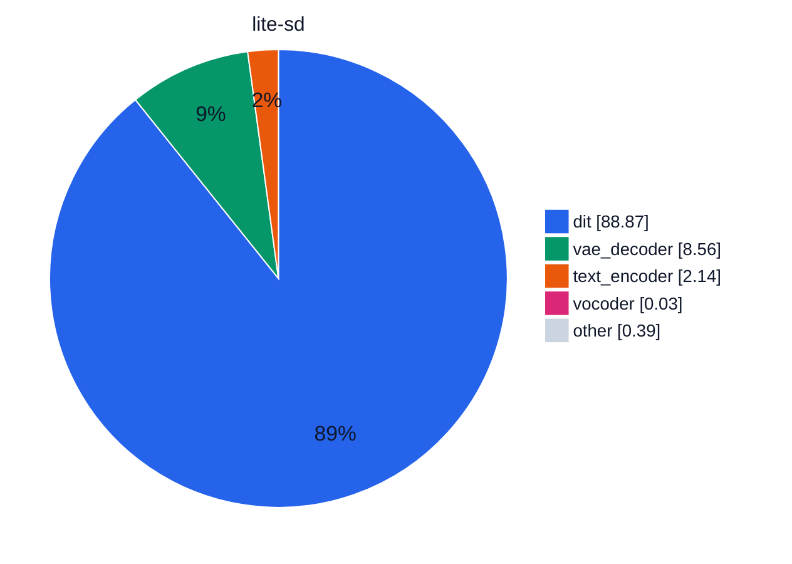
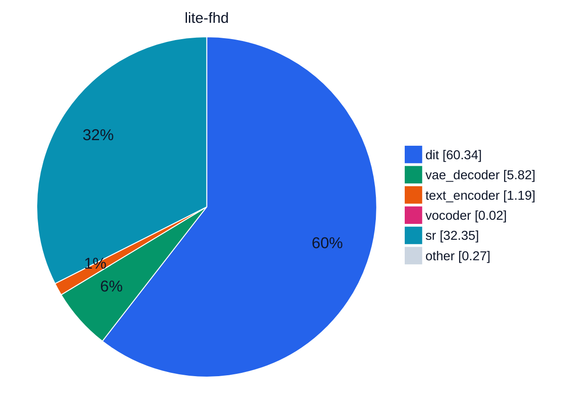
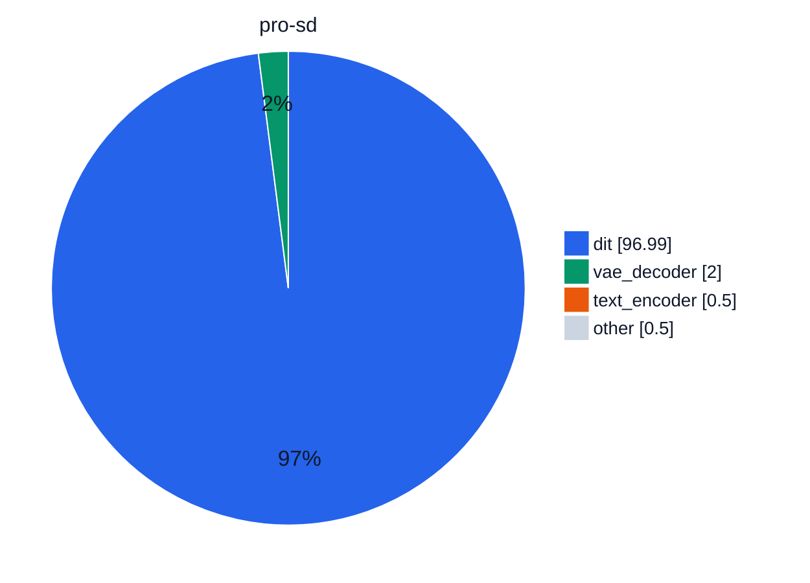
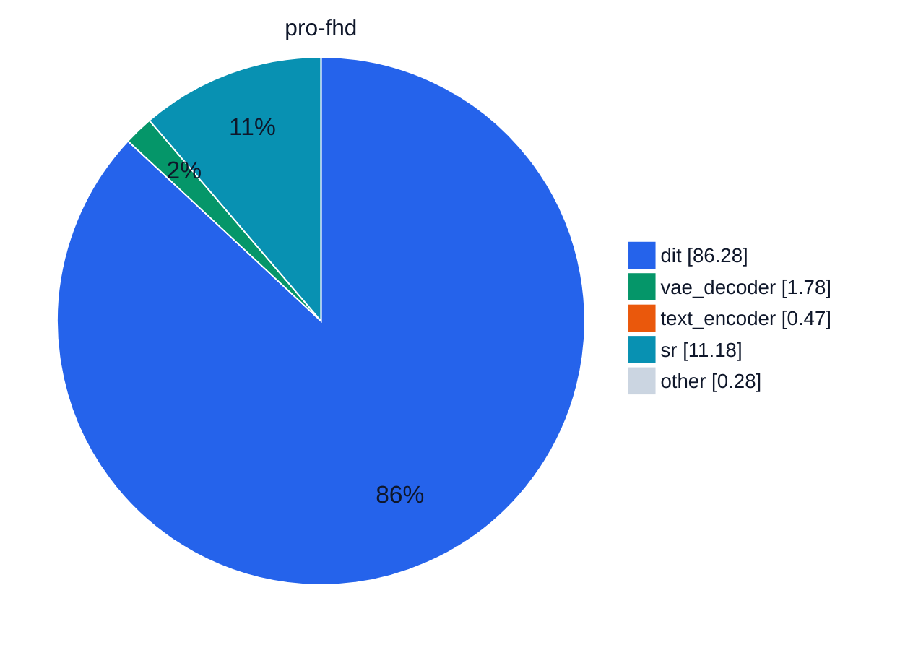

# Module time share

Collected profiles on NVIDIA GeForce RTX 5090, 32 GB.

SageAttention, Qwen in BF16, compile torch. Each cell is one profiled generation. Lite stays resident. Pro uses block offload. The base clip is 480×864 with audio. Full HD is that clip plus the distilled 2-step model at scale 2.25. Distilled checkpoints use PiFlow, 10 steps, and guidance 1. The other checkpoints use 50 steps, guidance 5, and MagCache.

The time under a run name is that profile, base plus super-resolution. A slice is that module's share of the same total. Charts are [Mermaid pie charts](https://mermaid.js.org/syntax/pie.html). Slice colors are `pie1`…`pie12` on the `base` theme, set per chart so a module keeps its color. Slices under 0.01% are omitted, because a Mermaid pie value must be greater than zero.

<i style="background:#2563EB"></i>dit <i style="background:#059669"></i>vae_decoder <i style="background:#EA580C"></i>text_encoder <i style="background:#DB2777"></i>vocoder <i style="background:#7C3AED"></i>audio_vae_decoder <i style="background:#CA8A04"></i>text_encoder_2 <i style="background:#0891B2"></i>sr <i style="background:#CBD5E1"></i>other

## Charts

### Lite distill

### Pro distill

### Lite

### Pro

## Share of total time, %

Cell colors come from a `

| run | dit | vae_decoder | text_encoder | vocoder | audio_vae_decoder | text_encoder_2 | sr | other |
| --- | --- | --- | --- | --- | --- | --- | --- | --- |
| lite-distill-sd <small>44.2 s · none</small> | 50.4 | 39.0 | 8.37 | 0.15 | &lt;0.01 | &lt;0.01 | 0 | 2.05 |
| lite-distill-fhd <small>140.3 s · none</small> | 15.9 | 12.3 | 2.61 | 0.05 | &lt;0.01 | &lt;0.01 | 68.6 | 0.59 |
| pro-distill-sd <small>174.5 s · block</small> | 87.1 | 8.81 | 2.12 | 0.04 | &lt;0.01 | &lt;0.01 | 0 | 1.97 |
| pro-distill-fhd <small>269.5 s · block</small> | 56.4 | 5.70 | 1.22 | 0.02 | &lt;0.01 | &lt;0.01 | 35.9 | 0.81 |
| lite-sd <small>201.3 s · none</small> | 88.9 | 8.56 | 2.14 | 0.03 | &lt;0.01 | &lt;0.01 | 0 | 0.39 |
| lite-fhd <small>296.2 s · none</small> | 60.3 | 5.82 | 1.19 | 0.02 | &lt;0.01 | &lt;0.01 | 32.4 | 0.27 |
| pro-sd <small>768.0 s · block</small> | 97.0 | 2.00 | 0.50 | &lt;0.01 | &lt;0.01 | &lt;0.01 | 0 | 0.50 |
| pro-fhd <small>862.8 s · block</small> | 86.3 | 1.78 | 0.47 | &lt;0.01 | &lt;0.01 | &lt;0.01 | 11.2 | 0.28 |

